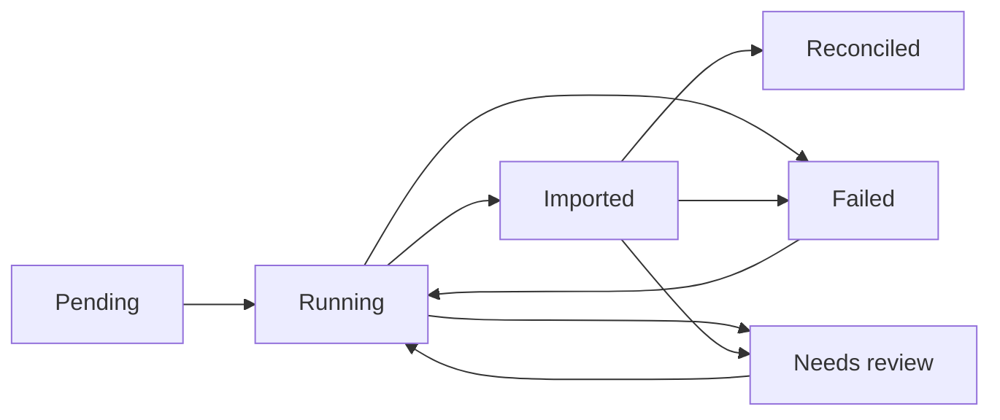

# Local snapshot import jobs — item18

Status: implemented local/test slice; final verification/runtime evidence is in [implementation status](../../implementation-status/current.md). Real source/CDC/business/account gates remain unverified.

## Decision and data

Reviewed migration0005 adds `platform.local_sync_jobs` and `platform.local_sync_attempts`. Existing source/event/outbox/audit tables and credentials are retained. Reuse the intake role and existing pg/TypeScript/NestJS/jose libraries; no new service, broker, cache, login or paid dependency. The source reader and private-spool publication protocol are unchanged.

A job is unique by synthetic workspace+capture UUID. Its generated bigint ID/UUID, capture, SHA256 and total are registered once. The SHA256 covers the complete validated frozen snapshot with recursively sorted JSON object keys; formatting/key order does not change identity, while changed fields/order/observation time/generation do. A changed file under an existing capture returns SNAPSHOT_CONFLICT before source writes. This is a consistency fingerprint, not authentication, encryption, account identity or tamper-proof storage.

Each attempt retains its own processed/inserted/duplicate counts, import_completed flag, reconciliation outcome, fixed error code and start/finish times. `processed=inserted+duplicate` counts committed event checks, including exact duplicates; it never counts a failed/unknown row as committed. `total-processed` is remaining evidence to check, including any failing row. A retry starts at the beginning with a new attempt; old attempt evidence is retained. Counts across attempts must not be summed as unique transactions or fraud metrics.

## Lifecycle and ownership

An active job has a rotating UUID token and a10-second database-clock lease. Claim locks the job row: one concurrent owner proceeds, others get busy. Once the lease expires, a new claim marks the prior running attempt interrupted/LEASE_EXPIRED and starts a fresh fenced attempt. At most32 attempts per local job; this bounded development policy requires a reviewed change if exhausted. No automatic retry scheduler or worker daemon exists.

Each event uses **one database transaction**: lock/check job scope+capture+attempt+token, require the next ordinal, append source record/event using the shared existing intake helper, update that attempt's committed counters, then verify/renew the live lease. If ownership expires after staging the event, the final fence aborts both source and checkpoint. Job row locking serializes reclaim against an in-flight transaction. Existing statement/lock/idle budgets remain; no long source transaction is held during PostgreSQL import.

After every event is checked, imported records the separate import-completion phase and renews the lease. The existing bounded, exact reconciliation then runs using the app-role reader. Only PASS can finish reconciled; FAIL becomes needs_review, UNAVAILABLE/LIMIT_EXCEEDED become failed with distinct codes. Source evidence conflict becomes needs_review/EVENT_CONFLICT without overwriting evidence. Storage failure can record failed only if the status transaction itself succeeds; otherwise return unavailable/stale and leave the last durable state for later inspection/reclaim.

While an expired attempt has not been reclaimed, its stored state can remain running/imported. Read APIs derive effective_status=interrupted without inventing a completion time or forcing a database update on every poll. Reclaim later persists the interruption. A completed job returns already_reconciled without adding an attempt; that is its **historical recorded result**, not a new reconciliation or proof that target data cannot subsequently change. Use source:reconcile for a fresh diagnostic check. There is no cross-database transaction, CDC offset/checkpoint, snapshot-to-binlog handoff or continuous-source completeness claim.

## CLI and read API

`pnpm source:import <capture_id>` now runs the tracked import **and** reconciliation. It reads the existing private spool, never reopens MariaDB, and emits capture/job references, attempt number and a fixed status only. Exit0 is reconciled/already_reconciled; exit2 is busy/stale/unavailable/failed/needs_review; invalid input/configuration/frozen-evidence conflict exits1 with redacted diagnostics. Failed-command output cannot prove that the last COMMIT did not happen: inspect persisted status or retry the same frozen capture. Pending jobs can exist after a crash between registration and claim.

`source:capture` and the reader's400-event/2MiB/local-only bounds are unchanged. `source:reconcile` remains a separate read-only diagnostic and does not change job history. The original importSnapshot/createSourceIntake primitives remain for existing reference/tests; they do not create job history. Operational tracked writes use the import CLI/runSyncJob path. Intake credentials are a trusted internal service boundary, not a sandbox against malicious direct SQL.

When the existing private local auth profile is enabled:

| Endpoint | Contract |
| --- | --- |
| GET /v1/local/sync/jobs?after=0&limit=25&capture_id=optional | Independent sync:read; verified-token workspace, bigint-text job cursor, explicit last_attempt null for pending/no attempt |
| GET /v1/local/sync/jobs/{job_ref}/attempts?after=0&limit=25 | Same scope/workspace; ascending attempt cursor, max32 stored attempts; unknown/foreign job returns empty page |
| GET /v1/local/audit/events?job_ref=UUID | Separate audit:read; job lifecycle evidence; job_ref and intent_ref filters are mutually exclusive and enforce target type |

All pages are bounded100+1, live_committed_view; each statement has its own snapshot. IDs allocate before COMMIT, so these browsing cursors are not a reliable incremental feed/stable export. APIs exclude fingerprint, lease token, source payload/key, DSN and credentials. Missing/invalid auth401, denied scope403, bad/duplicate/unknown input400, storage unavailable503; unavailable never becomes an empty/zero successful report. Generated request IDs/no-store remain, no mutation endpoint is added, readiness stays503.

After a successful tracked import, `pnpm api:sync-smoke <capture_id>` creates temporary local public-key configuration/listener, checks401/403/200 plus persisted job/attempt results, prints counts only, then closes/removes those resources. It performs no import or provider call.

## Audit, permissions and backup

Audit schema version1 remains outbox evidence; version2 adds typed local_sync_job target, capture UUID, previous/current phase and actions sync.job_created/sync.job_updated/sync.attempt_finished. Correlation is the generated job UUID; an attempt completion/interruption retains its attempt number. Protected owner-executed triggers record lifecycle changes in the same transaction. Progress/lease heartbeats alone do not create audit rows. A successful first job normally creates five audit rows; retries add lifecycle evidence without logging raw events.

The intake role can register jobs, advance approved state/counter columns and append source evidence; frozen capture/hash/total/generated IDs are not writable. App can only SELECT jobs/attempts, outbox role has no job access. Workers have no direct audit INSERT/UPDATE/DELETE or protected-function EXECUTE. Database session_user is the service actor; real employee/OIDC/institution policy, row security and privileged-admin audit remain future gates. The migration owner/superuser can change this evidence; it is not WORM storage. No old captures are automatically registered/backfilled.

Backup fingerprints jobs/attempts/audit with the same exported snapshot. Restore accepts only the exact reviewed current inventory or the two older pre-job/pre-audit inventories, retains their original migration prefix, and checks app read-only grants. Unknown inventories still fail. Existing1000-rows/table,32MiB archive and native tool time bounds remain local limits, not production retention/DR policy.

## Verification and limits

Native tests kill a real child process after a committed event, reclaim/replay/fence it, contend concurrent workers, change frozen evidence, block source/audit writes and force lease loss after staging an event to prove rollback. Other cases cover conflict/reconciliation failure/unavailable, phase distinction, budgets/grants, current/older backup restore, HTTP scopes/workspace isolation/full-precision cursors/redaction/outage/OpenAPI. Final full/fresh counts and actual private-spool smoke results are recorded in status.

No real replica was contacted or source configuration changed. These jobs track a bounded local frozen snapshot, not production batch backfill or incremental CDC. No throughput/accuracy/availability acceptance follows from the tests. Retention, durable external manifests, real source identity/business semantics and operational capture/stream selection still require their planned evidence and approvals.
