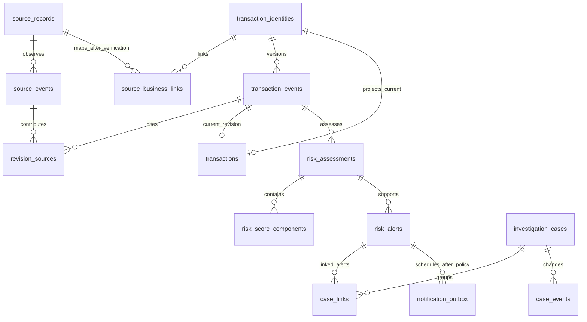

# PostgreSQL Logical Model — No.7

Item10 implementation note: a bounded **local synthetic** source_records/source_events slice now exists; see [intake contract](../data-dictionary/local-source-intake.md). This does not approve the broader logical/business model or real source identity/CDC protocol. The rest of this document retains its item7 draft/design scope.

Status: **DRAFT_FOR_REVIEW**, 2026-10-18. Logical entities/constraints and query proposals only. No DDL, database, driver, physical partition choice, owner approval or capacity measurement is implemented here. Source facts/gates are in [Source Mapping](../data-dictionary/source-mapping.md); growth strategy remains in [plan/08](../../../plan/08-postgresql-enterprise-design.md).

## 1. Boundaries and scope

Keep source observations, normalized payment revisions, current views and risk/investigation evidence separate. One mutable transaction row cannot reproduce which input an old assessment used. An unresolved source row can remain in approved restricted intake; it must not become a verified payment/account solely to satisfy a required field.

Every relationship carries a stable `workspace_key`. Workspaces isolate test/replay/backfill/shadow outputs from operational live state; `execution_mode` and `run_id` remain auditable producer context. A changing live process run ID must not defeat event deduplication. Institution/case visibility is a separate authorization scope: a routing bank code is not a tenant or account ownership grant. Actual roles/RLS/access policy require security review, not merely schema names.

Internal joins propose `BIGINT` surrogate keys; externally exposed IDs remain bounded opaque strings matching the existing contracts. Source references may exceed 128 characters and require a protected registry/encoding decision; they are not truncated into public IDs. Complete natural source keys and their comparison semantics remain available to authorized collision/identity checks. Internal sequence values are not business IDs or authorization tokens.

## 2. Logical relationships

This diagram describes cardinality, not a requirement to create one physical table per box. `transaction_identities` can reside with unpartitioned `transactions`; a separate registry/locator is a conditional physical option if partitioned bodies need global identity. `transaction_events` retains the plan's canonical-history name: each row represents an immutable normalized revision/event and references input observations, while `source_events` records capture observations. The existing Transaction wire model serializes a revision; no raw CDC event contract is added. `revision_sources` explicitly permits multiple input observations per revision. An alert can belong to multiple cases through scoped links.

## 3. Intake and lineage

| Logical entity | Proposed attributes and constraints | Mutation/access |
| --- | --- | --- |
| `source_records` | Internal key; workspace/source namespace/source generation/table; opaque `record_ref`; complete typed source PK reference; key encoding/normalization version; classification | Unique complete approved source identity and unique scoped opaque handle. Registration is not business-payment resolution. Protect original key values; do not expose in public lookup or audit text |
| `source_events` | Event key; source record; capture kind/epoch/position/row ordinal/operation; input schema ref; observed/recorded times; optional proven source commit time; approved evidence ref/integrity ref | Append-only observations. Unique stable event identity once capture protocol is approved; record refs alone cannot deduplicate changes. Missing business mapping does not destroy lineage |
| `ingestion_dedup` | Sink semantic scope + stable source event identity; applied effect/version reference | Unique non-null identity per sink; insert atomically with sink effects. Run trace is not a live dedup key. Retention must cover accepted replay/recovery horizon |
| `ingestion_quarantine` | Source event/evidence ref, disposition/reason, mapping version, first/last seen, retry state, resolution audit | Controlled reprocessing, permission-limited values via evidence reference; no account payload in exception messages. Not a payment hold |
| `source_business_links` | Source record or approved relationship ref; canonical transaction identity; mapping/approval version; effective interval and supersession evidence | Versioned, reviewed linkage. No global `UNIQUE(reference)` assumption. A conflicting active link blocks publication; corrections preserve prior evidence |

Missing/invalid keys are not stored as all-zero placeholders or NULL-containing dedup keys. Capture failure recovery must retain enough original identity to distinguish a retry from a distinct event. Payload hashes help integrity comparisons but do not identify two identical successive source changes. No snapshot watermark or CDC serializer is invented here.

## 4. Canonical payments and current view

| Logical entity | Proposed attributes and constraints | Mutation/access |
| --- | --- | --- |
| `transaction_identities` | Workspace/internal key; opaque `transaction_id`; approved business namespace/key reference; mapping version and resolution evidence | Unique scoped public ID and, once approved, complete business key. Key changes/reconciliation require versioned links; unresolved business identity stays in intake |
| `transaction_events` (immutable canonical revisions) | Identity + opaque revision; source refs; sender/receiver resolution state + optional entity refs; owning-bank refs if resolved; exact amount/currency; nullable occurred time; observed/recorded times; lifecycle/type/channel + mapping provenance | Immutable `(workspace, transaction, revision)`; full source-to-revision lineage. Required fields cannot be fabricated from unverified codes. Canonical status `unknown` is distinct from ingestion processing state |
| `transactions` | Scoped transaction identity; current revision ref; selected hot filter columns; last applied ordering provenance; eligibility/projection version; visibility scope | Mutable narrow projection, unique one row per scoped identity. Complete FK to the selected immutable revision. Avoid embedding all history or large JSON payloads |
| `revision_sources` | Complete revision ref + source event ref + contribution/mapping version | Unique scoped link, preserving which observations supported which normalized revision |

Canonical accounts may be unresolved, in which case entity/owning-bank keys are NULL with explicit resolution status/reason. Resolved account refs require approved stable identity and namespace; masked display text never participates in a unique account constraint. Routing participant refs can exist separately from nullable owning-bank refs. `institutions/institution_aliases` and future `entities/entity_aliases` need validity, source namespace and mapping version; their operational population remains gated.

The wire contract represents one revision, so API serialization of current state must use the revision referenced by `transactions`, not merge arbitrary newest columns. Reassessment of an old revision does not change payment history. Source deletes/history moves are source operations; only verified business lifecycle events can establish reversals.

## 5. Risk, alerts, investigations and notifications

| Logical entity | Proposed attributes and constraints | Lifecycle |
| --- | --- | --- |
| `risk_assessments` | Workspace/assessment ID; complete transaction revision FK; assessed time; run/mode; feature/vendor refs; engine/rule/policy versions; decision status/action/reasons; input eligibility | Immutable assessment, new ID for rescore. Decision record does not authorize payment enforcement. Mode/revision mismatch is rejected |
| `risk_score_components` | Scoped assessment FK + dimension; status/value/meaning; engine/calibration refs; unavailable reason | One final aggregate component per required fraud/mule/AML dimension; per-engine evidence is separately referenced. Three required components must be committed together; FK/UNIQUE alone do not enforce this cardinality |
| `latest_risk` | Workspace + subject/approved use scope + policy eligibility; complete assessment ref + transaction revision | Rebuildable read model; conditional version update only. A later timestamp, backfill or replay must not replace an eligible live assessment |
| `rule_versions`, `policy_versions`, artifact references | Immutable published version; approval/effective scope; retirement/supersession refs | Never overwrite an artifact used by evidence. Full rule/model registry integration is later work |
| `risk_alerts`, `alert_evidence_links`, alert state events | Alert/policy ID; complete assessment FK; transaction/revision; dimension/severity/reasons; visibility scope; grouping identity; state/revision | Evidence snapshot remains immutable; assignment/workflow changes append history under optimistic concurrency. An alert is not a case, label, verdict or delivered notification |
| `investigation_cases`, `case_links`, `case_events` | Case/revision/assignment/status/scope; scoped links to alerts/evidence; actor/reason/time | Controlled state machine; atomic state/event change, expected revision and permissions checked server-side |
| `investigation_outcomes`, `label_reviews` | Dimension/subject, outcome, evidence/reviewer/confidence; occurrence/recorded/mature-at times; review/supersession versions | Append reviewed outcomes; unknown/not-alerted are not legitimate labels; corrections do not silently alter a training dataset |
| `notification_outbox`, `notification_attempts`, acknowledgements | Approved alert/recipient/channel/policy intent; mode/TTL/due/lease/retry state; attempt/provider refs; user acknowledgement separately | One semantic intent, bounded retry/lease recovery; provider acceptance does not prove device receipt or user acknowledgement. No live recipients/device/provider configuration exists |
| `audit_events`, protected evidence/archive refs | Actor/action/target/reason/correlation/time/version/authorized refs | App-role append-only with independently protected retention/archive; a table name alone does not make logs immutable |

Unavailable score requires NULL value and reason; available risk index is bounded but not a probability; probability additionally requires approved calibration evidence. Missing is not zero. Cross-table references must include workspace and full revision/assessment identity; storing both `assessment_id` and a different transaction/revision is rejected. Use composite FK/UNIQUE designs for these relationships, not cross-table CHECK expressions. [PostgreSQL constraints](https://www.postgresql.org/docs/current/ddl-constraints.html) do not support reliable cross-table CHECK invariants.

Future device/inbox/auth schemas are outside this batch. Notification/effect generation must check live scope, recipient authority, policy version and expiry. Replay, shadow, backfill and test never inherit live side effects from a copied alert payload.

## 6. Types, NULLs and precision

- Source `DECIMAL(24,2)` motivates `NUMERIC(24,2)` for confirmed comparable payment magnitudes, pending units/sign/product bounds. Wider draft wire values are not automatically valid for that store. Validate exact scale/range before binding: a fixed-scale PostgreSQL numeric can round extra fractional digits. Never let this coercion decide financial semantics. Driver/API values remain decimal strings. [PostgreSQL numeric behavior](https://www.postgresql.org/docs/current/datatype-numeric.html)
- Source `id INT(11)` is a declared integer, not an eleven-digit account identifier. Source `reference`/participant strings preserve leading zeros and approved collation/equality semantics. `iin` is not declared unique in the inventory.
- Use `TIMESTAMPTZ` for known instants; record source timezone/interpretation provenance separately. Source naive DATETIME does not become UTC by casting. Nullable occurred/source-commit time is different from actual observed/recorded time. Preserve corrections as revisions.
- Typed columns hold hot lookup/filter/join data. Versioned JSONB can hold approved bounded extensions or typed-key evidence in a protected area; it is not a universal hot row or an unreviewed raw payload dump.
- Required identity/dedup components use NOT NULL; unresolved account/bank/time fields have explicit companion status/provenance. NULL-containing UNIQUE tuples are not evidence that duplicates are impossible. Score-state checks must validate required nullability as well as bounds.

## 7. Atomic writes and concurrency contracts

These are acceptance requirements for a future worker, not implemented transactions:

1. Capture commits durable source observations/positions under its approved protocol; canonical validation/mapping cannot erase original authorized evidence. Capture offset ordering and snapshot stitching remain G-CAPTURE.
2. A normalization/sink unit validates mode, mapping, complete identity and source ordering; then writes sink dedup, immutable revision/lineage and eligible current projection in one short DB transaction. Invalid/unknown required values go to controlled intake disposition instead.
3. Distinct events can map to an unchanged canonical state; retain their source lineage without inventing duplicate business payments. Two events with equal payloads are not automatically the same event. Conflicting event identity/payload or ambiguous order is quarantined, not silently ignored.
4. Consumer acknowledgement advances only after durable DB effects. Crash after commit but before ACK must replay idempotently. Out-of-order older revisions remain evidence and cannot regress current projection. PK edits/restore epochs and multi-partition ordering require explicit protocols.
5. Assessment/components/evidence/latest-view updates are atomic and version-conditional. Alert/state history plus notification intent are atomic when policy authorizes them. External push happens after commit under a lease; retry-after-provider-acceptance may physically duplicate a push.
6. Case/assignment/outcome updates require expected revision, permissions and corresponding audit/state events. Cross-workspace and assessment/revision inconsistencies must fail atomically.

Future integration tests must force concurrent inserts, stale versions, contradictory duplicate payloads, rollback, crash-before/after-commit and replay. Fixture equality tests in No.7 do not prove any of these database guarantees.

## 8. Query and index candidates

Every candidate includes the access/visibility predicates required by the approved authorization model. Selectivity and actual queries decide index creation; no indexes are created here.

| Query | Proposed access/index shape | Correctness/performance gate |
| --- | --- | --- |
| Public transaction detail | Unique `(workspace, transaction_id)` or approved global locator; current revision lookup | No scan of all historical partitions; backend checks visibility |
| Source reference drill-down | Scoped opaque `record_ref`, then source events by record/ordering/time | Original key lookup restricted; neither raw reference nor unverified bank joins exposed |
| Sender/receiver timeline | Separate `(workspace, entity_key, occurred_at DESC, transaction_key DESC)` paths | Enabled only for verified account entities; keyset cursor binds scope/filter/order; unknown-time behavior explicit |
| Institution monitoring | Approved visibility membership + event/business time/current key | Routing participant filter is not owning-bank authorization; measure fanout/multi-bank access |
| Assessment detail/history | Complete assessment ref; `(workspace, transaction_key, assessed_at DESC, assessment_key DESC)` | Revision/mode visible; latest endpoint uses eligibility read model |
| Open alerts | `(visibility_scope, priority DESC, created_at DESC, alert_key DESC)` with active-state predicate if appropriate | Measure state/parameterized query selectivity; no client-side full queue |
| Investigator cases | `(workspace, assigned_to, state, updated_at DESC, case_key DESC)` | Multi-state sort/pagination measured; expected revision on edits |
| Due outbox/reclaim | Separate due-state and expired-lease access paths | Short claim/commit before IO, bounded claims, lease fencing and recovery |
| Append-time retention/audit scan | Range partition and possible BRIN on correlated recorded time | Backfill concentration and late events benchmarked; cannot replace account point indexes |

B-tree equality/range/order layout must match the actual predicates; extra INCLUDE/JSONB indexes add write/storage cost. [PostgreSQL multicolumn indexes](https://www.postgresql.org/docs/current/indexes-multicolumn.html) explains why a column list alone cannot establish query performance.

## 9. Physical design, retention and security gates

Append-heavy events/assessments/audit are time-range partition candidates. Current payments require comparison of an unpartitioned indexed projection versus partitioned body with a global identity locator. Do not choose daily/monthly partitions, sharding, node count or retention from the 5-million/day growth target alone. Peak, bytes, versions/events per payment, query mix, hot keys, late data and snapshot distributions remain unknown.

A partitioned PK/UNIQUE must include the partition key; a day-plus-ID constraint is not global ID uniqueness. Choose either complete composite references including routing day, or an approved global identity registry with atomic body routing/lookup. Existing wire IDs contain no partition day, so public lookup must have a locator/resolution strategy before such a physical choice. Business source uniqueness still needs its separate approved complete key. [PostgreSQL partitioning](https://www.postgresql.org/docs/current/ddl-partitioning.html)

Physical routing date must not silently move when business occurred time is corrected. Queries need proven routing/pruning predicates; do not exclude late records by guessing their partition from occurred time. Pre-creation, missing-partition handling, retention automation, migration rollback and index/build strategy require staging evidence.

Retention is per data class: source evidence/keys, dedup, current/history, assessments/artifacts, cases/labels and notifications. Legal holds and open-case evidence may prevent partition deletion. Deleting a locator while references survive is invalid. Archive must remain authorized and resolvable; if data is deliberately deleted, retain approved disposition evidence rather than pretending the source never existed. No TTL/drop job is enabled.

Before migrations select supported PostgreSQL/pg/Drizzle versions, app/migration/readonly/worker roles and grants; pool/concurrency budgets; encryption/secrets handling; audit access/independent protection; backup/PITR/restore, RPO/RTO and source rebootstrap/reconciliation. No account data, credentials or new connection settings are created in No.7. This model prepares review and future tests; it does not claim measured capacity or a production-ready database.
